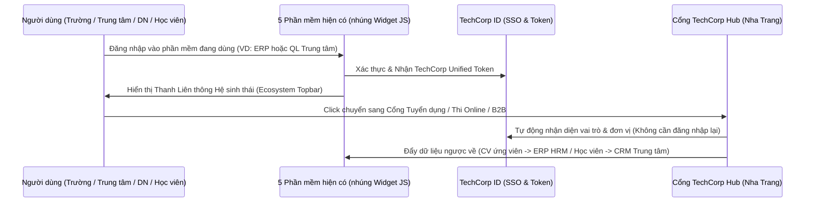

# TÀI LIỆU TRIỂN KHAI CHI TIẾT GIAI ĐOẠN 1 (THÁNG 1 - THÁNG 3)
## CHUẨN HÓA LIÊN THÔNG KỸ THUẬT & XÂY DỰNG HẠT NHÂN TẠI NHA TRANG

---

## PHẦN 1: CHUẨN HÓA LIÊN THÔNG KỸ THUẬT (KHÔNG ĐẬP ĐI XÂY LẠI)

Để 5 dòng sản phẩm hiện có của TechCorp (**Quản lý Trường học**, **Quản lý Trung tâm NN-TH**, **Học & Thi Online**, **Website Doanh nghiệp**, **ERP**) hoạt động như một thể thống nhất chỉ trong **2 - 4 tuần đầu tiên**, chúng ta áp dụng kiến trúc **Liên thông Lớp Giao diện (Federated UI) & Cổng API Trung gian (Hub Gateway)**.

### 1.1. Ba thành phần kỹ thuật triển khai ngay trong Giai đoạn 1

1. **Thanh Liên thông Nhúng (`widget/techcorp-ecosystem-bar.js`):**
   * Chỉ cần nhúng **1 dòng `<script>`** vào header của 5 phần mềm hiện tại.
   * Cung cấp **App Switcher (Chuyển đổi nhanh giữa 5 sản phẩm)**, thông báo chéo (VD: *"Có 5 sinh viên ĐH Nha Trang vừa đạt chứng chỉ Tiếng Anh B2 phù hợp với vị trí Lễ tân khách sạn bạn đang tuyển trên ERP"*), và nút mở nhanh **TechCorp Hub**.
2. **Chuẩn hóa Hồ sơ Năng lực Số (`TechCorp Talent Passport Schema`):**
   * Kết quả học tập từ **Phần mềm Trường CĐ/ĐH**, **Phần mềm Trung tâm NN-TH** và điểm thi từ **Hệ thống Thi Online** được xuất ra một định dạng JSON chuẩn duy nhất, có mã QR xác thực chống giả mạo.
   * Khi sinh viên/học viên ứng tuyển vào doanh nghiệp, dữ liệu JSON này tự động điền vào **Phân hệ HRM của ERP TechCorp**.
3. **Cổng Trung tâm `TechCorp Hub` (Web Portal):**
   * Đóng vai trò là "Quảng trường trung tâm" của hệ sinh thái tại Nha Trang: tích hợp **Sàn Nhân lực & Thực tập**, **Đấu trường Học & Thi Online**, **Chợ Giao thương B2B & Ưu đãi Phụ huynh/Sinh viên**, và **Công cụ Tính gói Combo Chuyển đổi số**.

---

## PHẦN 2: ĐÓNG GÓI SẢN PHẨM & BẢNG GIÁ COMBO TẠI NHA TRANG (GIAI ĐOẠN 1)

Thay vì bán lẻ từng phần mềm rời rạc, đội ngũ kinh doanh tại Nha Trang sử dụng **3 Gói Combo Mũi nhọn** dưới đây để chốt khách hàng hạt nhân nhanh trong 1 – 3 tuần:

### Gói 1: "Mầm non & Phổ thông Số Khánh Hòa" (Dành cho các trường Tư thục & Công lập)
* **Thành phần:** Phần mềm Quản lý Trường học + Sổ liên lạc Điện tử Đa phương tiện + Cổng Thi/Kiểm tra Online + Tích hợp Thu hộ Học phí Không tiền mặt.
* **Chính sách giá Hạt nhân (15 trường đầu tiên tại Nha Trang):**
  * **Miễn phí 100%** phí khởi tạo hệ thống và nhập liệu ban đầu.
  * Phí thuê bao SaaS: **15.000 VNĐ / học sinh / tháng** (Trường quy mô < 200 trẻ trọn gói chỉ **2.500.000 VNĐ/tháng**).
* **Quyền lợi Hệ sinh thái:** Phụ huynh của trường được tặng gói kiểm tra năng lực Ngoại ngữ - Tin học định kỳ miễn phí và nhận thẻ ưu đãi học bổng từ các Trung tâm NN-TH uy tín tại Nha Trang.

### Gói 2: "Tăng tốc Tuyển sinh & Đào tạo Trung tâm" (Dành cho Trung tâm Ngoại ngữ - Tin học)
* **Thành phần:** Phần mềm Quản lý Trung tâm (CRM Tuyển sinh, Lớp học, Học phí) + Nền tảng Học & Thi Online (LMS/E-Testing) + Website Tuyển sinh Chuẩn SEO.
* **Chính sách giá Hạt nhân (10 trung tâm đầu tiên tại Nha Trang):**
  * Trọn gói Combo: **1.800.000 VNĐ / tháng** (thanh toán theo năm được tặng ngay **Website Trung tâm trị giá 8.000.000 VNĐ**).
* **Quyền lợi Hệ sinh thái (Vũ khí chốt sale):**
  * Được đứng tên đồng tổ chức các kỳ **"Thi thử IELTS/TOEIC/Tin học Trực tuyến toàn tỉnh Khánh Hòa"** trên nền tảng TechCorp để thu hút hàng ngàn học viên từ các trường phổ thông/đại học.
  * Học viên xuất sắc của trung tâm được giới thiệu việc làm/thực tập thẳng tới các Doanh nghiệp Du lịch - Khách sạn trong hệ sinh thái TechCorp.

### Gói 3: "Bệ phóng Doanh nghiệp Số Nha Trang" (Dành cho Doanh nghiệp SME)
* **Thành phần:** Website Doanh nghiệp Đa ngôn ngữ + Hệ thống Micro-ERP (CRM Quản lý Khách hàng + HRM Nhân sự/Chấm công + Quản lý Công việc) + Tài khoản VIP Tuyển dụng Nhân sự Hệ sinh thái.
* **Chính sách giá Hạt nhân (30 doanh nghiệp SME đầu tiên tại Nha Trang):**
  * Trọn gói Combo (quy mô tối đa 30 nhân sự): **2.200.000 VNĐ / tháng**.
  * **Tặng 100% chi phí thiết kế Website Doanh nghiệp chuẩn SEO** (trị giá 10.000.000 VNĐ) khi ký hợp đồng ERP từ 12 tháng.
* **Quyền lợi Hệ sinh thái (Vũ khí chốt sale):**
  * Kết nối tuyển dụng trực tiếp sinh viên thực tập & mới ra trường từ ĐH Nha Trang, ĐH Khánh Hòa, CĐ Du lịch Nha Trang và học viên các Trung tâm Ngoại ngữ đã được xác thực năng lực.
  * Được phát hành ई-Voucher ưu đãi sản phẩm/dịch vụ tới tệp >10.000 phụ huynh và sinh viên trên App của TechCorp.

---

## PHẦN 3: DANH SÁCH MỤC TIÊU & KỊCH BẢN CHỐT KHÁCH HÀNG HẠT NHÂN TẠI NHA TRANG

### 3.1. Phân bổ Chỉ tiêu 57 Khách hàng Hạt nhân (Lighthouse Customers) trong 90 ngày

| Nhóm Đối tượng | Số lượng mục tiêu | Khu vực trọng điểm tại Nha Trang | Nhóm ngành / Đặc điểm ưu tiên |
| :--- | :---: | :--- | :--- |
| **1. Trường Đại học / Cao đẳng** | **02 trường** | Bắc Nha Trang (Vĩnh Hải, Vĩnh Hòa) & Trung tâm | Hợp tác cấp Khoa (CNTT, Ngoại ngữ, Du lịch, Kinh tế) hoặc Trung tâm Hỗ trợ Sinh viên & Quan hệ Doanh nghiệp trước. |
| **2. Trung tâm Ngoại ngữ - Tin học** | **10 trung tâm** | Khu đô thị Vĩnh Điềm Trung, Lê Hồng Phong, Phước Hải, Bắc Nha Trang | Các trung tâm quy mô 150 – 800 học viên đang quản lý bằng Excel/Zalo, cần công cụ thi thử Online để tuyển sinh mùa hè/đầu năm học. |
| **3. Trường Mầm non & Phổ thông** | **15 trường** | KĐT Mỹ Gia, Vĩnh Điềm Trung, Hà Quang (Lê Hồng Phong II), Bình Tân | Các trường mầm non tư thục chất lượng cao cần nâng tầm thương hiệu với phụ huynh và tự động hóa thu học phí. |
| **4. Doanh nghiệp SME** | **30 doanh nghiệp** | Trần Phú, Nguyễn Thị Minh Khai, Khu vực Bến du thuyền Ana Marina, KCN Đắc Lộc | Khách sạn 3-4 sao, Lữ hành, Nhà hàng/F&B chuỗi, Nha khoa/Phòng khám, Bất động sản, Phân phối thực phẩm/Yến sào. |

### 3.2. Kịch bản Tiếp cận Thực chiến (Sales Playbook)

#### Kịch bản A: Tiếp cận Giám đốc Trung tâm Ngoại ngữ - Tin học tại Nha Trang
> *"Chào anh/chị [Tên], bên em là nền tảng Giáo dục & Doanh nghiệp Số TechCorp tại Khánh Hòa. Tháng tới bên em phối hợp tổ chức chương trình **Kiểm tra Năng lực Ngoại ngữ & Tin học Trực tuyến miễn phí** cho học sinh, sinh viên tại Nha Trang trên hệ thống Thi Online của TechCorp, đồng thời kết nối đầu ra việc làm của học viên với hơn 30 doanh nghiệp Du lịch - Khách sạn tại Nha Trang. Bên em đang chọn **10 Trung tâm uy tín nhất tại Nha Trang** để đưa vào Cổng Đối tác Đào tạo chính thức và tài trợ trọn bộ **Phần mềm Quản lý Trung tâm + Phòng Thi Online riêng**. Em xin phép ghé trung tâm mình 20 phút sáng mai để demo trực tiếp quy trình hút học viên qua cổng thi này nhé ạ!"*

#### Kịch bản B: Tiếp cận Chủ Doanh nghiệp SME (Du lịch, Khách sạn, Dịch vụ, Thương mại) tại Nha Trang
> *"Chào anh/chị [Tên], hiện tại các doanh nghiệp ở Nha Trang thường gặp 2 bài toán lớn: một là thiếu nhân sự/thực tập sinh giỏi ngoại ngữ - tin học làm được việc ngay, hai là quản lý khách hàng (CRM) và nhân sự (HRM) còn rời rạc. Hệ sinh thái TechCorp bên em đang quản lý trực tiếp hệ thống đào tạo và thi Online của các trường và trung tâm ngoại ngữ tại Nha Trang. Khi anh/chị sử dụng gói **Quản trị Doanh nghiệp ERP tinh gọn (chỉ hơn 2 triệu/tháng)** của TechCorp, bên em **tặng miễn phí 100% Website Doanh nghiệp mới** và cấp quyền truy cập trực tiếp vào **Kho Hồ sơ Thực tập sinh & Nhân sự đã xác thực điểm thi Ngoại ngữ/Tin học** tại Nha Trang, đồng thời giúp anh/chị gửi ưu đãi dịch vụ tới hàng ngàn phụ huynh trong hệ thống trường học của TechCorp."*

#### Kịch bản C: Tiếp cận Ban Giám hiệu / Trung tâm Hỗ trợ Sinh viên các Trường CĐ - ĐH tại Nha Trang
> *"Kính gửi Quý Thầy/Cô Ban Giám hiệu / Trung tâm Hỗ trợ Sinh viên. Để hỗ trợ nhà trường nâng cao tỷ lệ sinh viên có nơi thực tập và việc làm đúng chuyên ngành ngay tại Khánh Hòa, TechCorp xin tài trợ miễn phí **Cổng Quản lý Thực tập, Hồ sơ Năng lực Số & Hệ thống Thi Trắc nghiệm Online** cho Khoa/Nhà trường. Toàn bộ dữ liệu tuyển dụng từ mạng lưới Doanh nghiệp sử dụng hệ thống ERP của TechCorp tại Nha Trang sẽ được kết nối tự động về cổng của Trường, giúp sinh viên ứng tuyển thực tập chính quy và nhà trường theo dõi được báo cáo tỷ lệ việc làm theo thời gian thực."*

---

## PHẦN 4: LỊCH TRÌNH HÀNH ĐỘNG 12 TUẦN (GIAI ĐOẠN 1)

| Tuần | Mục tiêu Kỹ thuật (Product & Hub) | Mục tiêu Kinh doanh & Cộng đồng tại Nha Trang | Chỉ số đo lường (KPIs) |
| :--- | :--- | :--- | :--- |
| **Tuần 1 - 2** | - Ra mắt cổng `TechCorp Hub` (Web MVP) - Hoàn thiện thanh nhúng `techcorp-ecosystem-bar.js` | - Rà soát 100% khách hàng cũ tại Khánh Hòa - Đóng gói bộ Sales Kit & Bảng giá 3 Gói Combo | - Cổng Hub chạy thực tế - 20 khách hàng cũ kích hoạt tài khoản Hub |
| **Tuần 3 - 4** | - Tích hợp xuất Hồ sơ Năng lực Số từ phần mềm Thi Online & Quản lý Trung tâm sang ERP HRM | - Tiếp cận 20 Trung tâm NN-TH & 30 Trường Mầm non tại các KĐT Nha Trang - Tổ chức **Cafe Quản trị Số Nha Trang số #1** | - Chốt 4 Trung tâm NN-TH - Chốt 5 Trường Mầm non - 25 CEO/Hiệu trưởng dự Offline |
| **Tuần 5 - 8** | - Mở cổng đăng ký Kỳ thi Thử Ngoại ngữ - Tin học Trực tuyến Khánh Hòa lần 1 - Tự động hóa phát hành E-Voucher chéo | - Đẩy mạnh gói Combo **Web + Micro-ERP + Tuyển dụng** cho khối SME Nha Trang - Ký biên bản ghi nhớ (MOU) với 2 Khoa/Trường CĐ-ĐH | - Chốt 15 Doanh nghiệp SME - Ký MOU 2 Trường CĐ/ĐH - 2.000 thí sinh đăng ký thi thử |
| **Tuần 9 - 12** | - Báo cáo phân tích dữ liệu liên thông toàn hệ sinh thái (Dashboard cho Trường & DN) | - Hoàn thành mục tiêu 57 đơn vị hạt nhân tại Nha Trang - Tổng kết Case Study thực tế để chuẩn bị đánh ra Cam Ranh, Ninh Hòa (Giai đoạn 2) | - Đạt mốc **57 đơn vị hạt nhân** - Doanh thu định kỳ (MRR) > 100 triệu/tháng tại Nha Trang |
