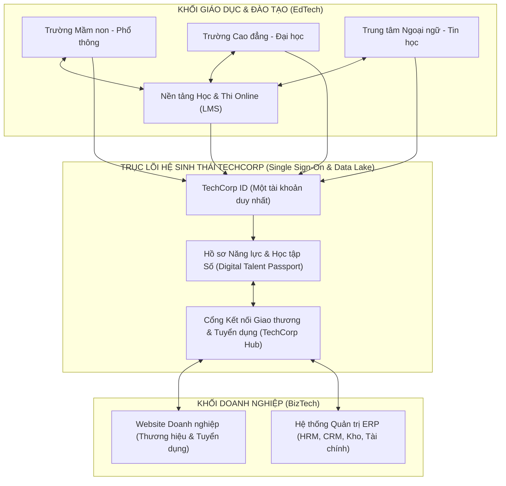
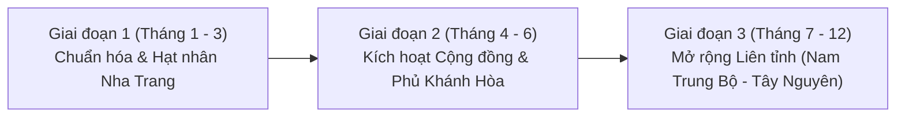

# KẾ HOẠCH XÂY DỰNG, TRIỂN KHAI VÀ VẬN HÀNH HỆ SINH THÁI SỐ TECHCORP
**Trọng tâm triển khai: Tỉnh Khánh Hòa & Khu vực Nam Trung Bộ - Tây Nguyên**

---

## 1. TỔNG QUAN & TẦM NHÌN CHIẾN LƯỢC

### 1.1. Bài toán hiện tại của TechCorp
TechCorp đang sở hữu một danh mục sản phẩm phần mềm rất mạnh và phủ rộng hai trụ cột lớn của nền kinh tế là **Giáo dục (EdTech)** và **Doanh nghiệp (BizTech)**:
1. **Hệ thống Quản lý Cơ sở Giáo dục (Mầm non đến Đại học):** Quản lý hồ sơ, học vụ, tài chính, điểm danh, sổ liên lạc điện tử.
2. **Phần mềm Quản lý Trung tâm Ngoại ngữ - Tin học:** Quản lý tuyển sinh (CRM), lớp học, lịch giảng, học phí, chăm sóc học viên.
3. **Nền tảng Học và Thi Online (LMS & E-Testing):** Kho học liệu số, phòng thi trực tuyến, cấp chứng chỉ số.
4. **Dịch vụ Website Doanh nghiệp:** Bộ mặt thương hiệu số, cổng thông tin, thương mại điện tử, tuyển dụng.
5. **Hệ thống Quản trị Doanh nghiệp (ERP):** Quản lý Nhân sự (HRM), Khách hàng (CRM), Tài chính - Kế toán, Kho vận, Công việc.

> [!IMPORTANT]
> **Vấn đề cốt lõi:** Nếu bán từng sản phẩm độc lập, TechCorp chỉ là một công ty gia công/bán phần mềm truyền thống (chi phí bán hàng cao, khách hàng dễ rời bỏ). Để tạo đột phá, TechCorp phải biến các sản phẩm này thành **Hệ sinh thái "Đào tạo – Nguồn nhân lực – Quản trị – Giao thương"**, nơi đầu ra của sản phẩm này là đầu vào của sản phẩm kia.

---

## 2. KIẾN TRÚC HỆ SINH THÁI TECHCORP & CƠ CHẾ KẾT NỐI DOANH NGHIỆP

### 2.1. Sơ đồ Kiến trúc Liên thông Hệ sinh thái

### 2.2. Kết nối các loại hình Doanh nghiệp & Tổ chức như thế nào?

Hệ sinh thái được kết nối qua **4 dòng chảy giá trị (Value Flows)**:

#### A. Dòng chảy Nguồn nhân lực & Đào tạo (Trường học / Trung tâm $\leftrightarrow$ Học viên $\leftrightarrow$ Doanh nghiệp)
* **Hồ sơ Năng lực Số (TechCorp Talent Passport):** Mỗi học sinh, sinh viên, học viên khi học tại các Trường ĐH/CĐ hoặc Trung tâm Ngoại ngữ - Tin học sử dụng phần mềm của TechCorp sẽ có một hồ sơ số ghi nhận kết quả học tập, chứng chỉ thi Online (xác thực chống giả mạo).
* **Kết nối Tuyển dụng & Thực tập tự động:**
  * Doanh nghiệp dùng **ERP (phân hệ HRM)** và **Website của TechCorp** khi đăng tin tuyển dụng/thực tập sinh sẽ được đẩy trực tiếp lên cổng việc làm của các Trường ĐH/CĐ và Trung tâm đào tạo trong hệ sinh thái.
  * Sinh viên/Học viên ứng tuyển chỉ bằng 1 cú click (dữ liệu từ LMS/Phần mềm trường tự động chuyển thành CV chuẩn xác thực đẩy thẳng vào phân hệ HRM của ERP doanh nghiệp).
* **Đào tạo Nội bộ Doanh nghiệp (Corporate Training):**
  * Doanh nghiệp dùng ERP cần đào tạo nhân sự mới hoặc nâng cao nghiệp vụ (Ngoại ngữ, Tin học, Kỹ năng) $\rightarrow$ Sử dụng ngay **Nền tảng Học & Thi Online** của TechCorp hoặc đặt hàng các **Trung tâm Ngoại ngữ - Tin học** trong hệ sinh thái với giá ưu đãi nội bộ.

#### B. Dòng chảy Khách hàng Chéo (Cross-selling B2B2C)
* **Trường Mầm non / Phổ thông $\leftrightarrow$ Trung tâm Ngoại ngữ - Tin học:**
  * Phụ huynh dùng App Sổ liên lạc điện tử của trường mầm non/phổ thông $\rightarrow$ Nhận được gợi ý học bổng, voucher khóa học hoặc bài test năng lực tiếng Anh/Tin học miễn phí trên hệ thống **Thi Online** từ các Trung tâm Ngoại ngữ - Tin học uy tín tại địa phương.
* **Doanh nghiệp $\leftrightarrow$ Cộng đồng Phụ huynh & Sinh viên:**
  * Hệ thống trường học từ Mầm non đến Đại học quản lý hàng chục ngàn phụ huynh và sinh viên. Các doanh nghiệp địa phương (Du lịch, F&B, Nha khoa, Y tế, Ngân hàng, Bán lẻ) dùng Website/ERP của TechCorp có thể phát hành ưu đãi độc quyền (Voucher gia đình, ưu đãi sinh viên) tới tệp người dùng khổng lồ này.

#### C. Dòng chảy Cung ứng B2B (Doanh nghiệp $\leftrightarrow$ Trường học / Trung tâm)
* Trường học và Trung tâm đào tạo cũng là những đơn vị tiêu thụ lớn (đồng phục, suất ăn công nghiệp, thiết bị văn phòng, tour dã ngoại, bảo hiểm, ngân hàng thu hộ học phí).
* Các doanh nghiệp sử dụng **Website + ERP của TechCorp** được ưu tiên đưa vào **"Danh bạ Nhà cung cấp Chuẩn TechCorp"**, kết nối trực tiếp với bộ phận thu mua của các trường học, trung tâm và các doanh nghiệp khác trong hệ sinh thái.

---

## 3. XÂY DỰNG CỘNG ĐỒNG CHO NỀN TẢNG TECHCORP

Để hệ sinh thái sống được, không thể chỉ kết nối bằng phần mềm mà phải có **Cộng đồng thực tế (Online + Offline)** chia theo 3 tầng:

| Tầng Cộng đồng | Đối tượng tham gia | Giá trị nhận được | Hoạt động chủ đạo |
| :--- | :--- | :--- | :--- |
| **1. TechCorp Leaders Club** (Cộng đồng Lãnh đạo) | Hiệu trưởng, Chủ trường mầm non tư thục, Giám đốc Trung tâm NN-TH, CEO/Chủ doanh nghiệp SME | Kết nối giao thương (matching B2B), chia sẻ quản trị số, tìm kiếm nguồn nhân lực chất lượng cao | - Cafe Quản trị Số hàng tháng - Hội thảo Chuyển đổi số Giáo dục & Doanh nghiệp - Group Zalo/Facebook VIP |
| **2. TechCorp Educators & HR Hub** (Cộng đồng Chuyên môn) | Giáo viên, Giảng viên, Quản lý đào tạo, Trưởng phòng Nhân sự (HR), Kế toán | Kho đề thi/bài giảng dùng chung, công cụ chấm thi AI, nguồn ứng viên thực tập/việc làm đã xác thực | - Cuộc thi thiết kế bài giảng số - Ngày hội Kết nối HR Doanh nghiệp & Trường học - Chia sẻ biểu mẫu ERP/HR chuẩn |
| **3. TechCorp Youth & Parents** (Cộng đồng Người dùng cuối) | Phụ huynh, Học sinh, Sinh viên, Người đi làm | Thi thử miễn phí (IELTS, TOEIC, Tin học, THPT), săn học bổng, tìm nơi thực tập/việc làm uy tín | - Cuộc thi Olympic Tiếng Anh / Tin học Online toàn tỉnh - Sàn Thực tập sinh & Việc làm TechCorp |

---

## 4. PHƯƠNG ÁN TRIỂN KHAI THỰC TẾ TẠI KHÁNH HÒA & KHU VỰC LÂN CẬN

### 4.1. Phân tích Đặc thù Thị trường Khánh Hòa & Vùng phụ cận
* **Tại Khánh Hòa (Nha Trang, Cam Ranh, Ninh Hòa, Diên Khánh, Vạn Ninh):**
  * **Khối Đại học/Cao đẳng rất tập trung tại Nha Trang:** ĐH Nha Trang, ĐH Khánh Hòa, ĐH Thái Bình Dương, CĐ Kỹ thuật Công nghệ Nha Trang, CĐ Du lịch Nha Trang, CĐ Y tế Khánh Hòa, CĐ Sư phạm Trung ương Nha Trang...
  * **Khối Mầm non tư thục & Trung tâm Ngoại ngữ - Tin học:** Phát triển cực kỳ sôi động tại Nha Trang, Cam Ranh, Ninh Hòa do nhu cầu tiếng Anh/Trung/Hàn/Nga phục vụ ngành Du lịch - Dịch vụ rất lớn.
  * **Khối Doanh nghiệp (SME):** Thế mạnh về Du lịch - Khách sạn - Lữ hành, F&B, Bất động sản, Thủy hải sản, Yến sào, Xây dựng và Dịch vụ cảng biển (Vân Phong, Cam Ranh). Các doanh nghiệp này đang rất khát nhân sự có ngoại ngữ/tin học và đang trong giai đoạn chuyển đổi số quản trị (cần Website chuẩn SEO đa ngôn ngữ + ERP tinh gọn).
* **Khu vực lân cận (Mở rộng vòng 2):**
  * **Ninh Thuận (Phan Rang) & Phú Yên (Tuy Hòa):** Khoảng cách chỉ 1.5 – 2 giờ di chuyển qua cao tốc/quốc lộ, thị trường ít đối thủ công nghệ bản địa, các trường và doanh nghiệp rất thiếu đơn vị hỗ trợ trực tiếp ("cầm tay chỉ việc").
  * **Đắk Lắk (Buôn Ma Thuột) & Lâm Đồng (Đà Lạt):** Thị trường giáo dục tư thục (mầm non, trung tâm ngoại ngữ) và doanh nghiệp nông sản - du lịch rất lớn, ngay sát Khánh Hòa.

### 4.2. Chiến lược "Đánh chiếm từng lớp" (Land & Expand) tại Khánh Hòa

#### Mũi nhọn 1: Dùng "Học & Thi Online + Quản lý Trung tâm/Mầm non" làm Phễu thu hút (Wedge Product)
* Các hệ thống ERP doanh nghiệp hay Quản lý Đại học thường có chu kỳ chốt sale dài (3–6 tháng). Ngược lại, **Website Doanh nghiệp**, **Quản lý Trung tâm Ngoại ngữ - Tin học**, **Mầm non tư thục** và **Thi Online** chốt rất nhanh (1–3 tuần).
* **Hành động thực chiến tại Nha Trang - Khánh Hòa:**
  1. **Tổ chức "Kỳ thi Thử Năng lực Ngoại ngữ & Tin học Trực tuyến tỉnh Khánh Hòa"** trên nền tảng Thi Online của TechCorp, phối hợp cùng 10–20 Trung tâm Ngoại ngữ - Tin học tại Nha Trang, Cam Ranh, Ninh Hòa và Đoàn Thanh niên / Hội Sinh viên các trường.
  2. Trung tâm có ngay hàng ngàn data học viên tiềm năng $\rightarrow$ Chốt ngay phần mềm **Quản lý Trung tâm + LMS** cho các trung tâm này.
  3. Cung cấp gói **"Chuyển đổi số Mầm non Tư thục Khánh Hòa"** với chi phí thuê bao (SaaS) cực kỳ hợp lý theo đầu trẻ (chỉ từ 10.000đ - 20.000đ/học sinh/tháng).

#### Mũi nhọn 2: Đưa Doanh nghiệp vào Hệ sinh thái qua "Combo Website + Tuyển dụng + ERP Tinh gọn"
* Thay vì bán lẻ một Website hay một bộ ERP đắt đỏ, hãy đóng gói thành **"Gói Bệ phóng Số cho Doanh nghiệp Khánh Hòa"**:
  * **Tặng/Ưu đãi 50% Website Doanh nghiệp chuẩn Chuyển đổi số** khi đăng ký sử dụng hệ thống **ERP (bắt đầu từ phân hệ CRM & HRM)** từ 12 tháng.
  * **Đặc quyền độc quyền:** Doanh nghiệp tham gia gói này được cấp tài khoản truy cập **Cổng Tuyển dụng Thực tập sinh & Nhân sự TechCorp Khánh Hòa** (kết nối trực tiếp với sinh viên ĐH Nha Trang, ĐH Khánh Hòa, CĐ Du lịch, học viên các trung tâm ngoại ngữ). Đây là "nỗi đau" lớn nhất của doanh nghiệp dịch vụ - du lịch tại Nha Trang hiện nay!

#### Mũi nhọn 3: Chinh phục khối Trường Phổ thông, Cao đẳng & Đại học
* Tiếp cận các trường CĐ/ĐH tại Khánh Hòa thông qua **Phân hệ Quản lý Thực tập, Việc làm Sinh viên & Thi Trắc nghiệm Online** trước (không đòi hỏi thay thế ngay lập tức toàn bộ hệ thống cũ nếu trường đang vướng hợp đồng), sau đó mở rộng sang toàn bộ hệ thống Quản lý Đào tạo tổng thể.

---

## 5. ĐÁNH GIÁ TÍNH KHẢ THI (FEASIBILITY ANALYSIS)

> [!TIP]
> **Kết luận ngắn gọn: Phương án này HOÀN TOÀN KHẢ THI và có lợi thế cạnh tranh rất cao tại Khánh Hòa**, miễn là TechCorp triển khai theo lộ trình **tích hợp cuốn chiếu** thay vì ôm đồm làm tất cả cùng lúc.

### 5.1. Tại sao phương án này khả thi cao tại Khánh Hòa?
1. **Lợi thế "Sân nhà & Hỗ trợ trực tiếp":** Các trường học, trung tâm và doanh nghiệp SME tại Khánh Hòa, Phú Yên, Ninh Thuận rất ngại mua phần mềm từ Hà Nội hay TP.HCM vì khi gặp sự cố không có người xuống tận nơi hỗ trợ. TechCorp có đội ngũ bản địa hỗ trợ tận nơi trong 2 giờ là lợi thế tuyệt đối.
2. **Sẵn có trọn bộ sản phẩm:** Các đối thủ trên thị trường thường chỉ có 1 mảng (ví dụ: chỉ làm phần mềm mầm non, hoặc chỉ làm ERP, hoặc chỉ làm web). TechCorp có cả 5 mảnh ghép nên có thể bán chéo (Cross-sell) với chi phí Marketing bằng 0 cho các sản phẩm thứ 2, thứ 3.
3. **Đúng thời điểm chính sách:** Tỉnh Khánh Hòa đang đẩy mạnh đề án Chuyển đổi số toàn diện hướng tới thành phố trực thuộc Trung ương vào năm 2030, các sở ban ngành, trường học và hiệp hội doanh nghiệp (như Hội Doanh nhân trẻ Khánh Hòa, Hiệp hội Du lịch Nha Trang - Khánh Hòa) rất cởi mở với các nền tảng công nghệ địa phương.

### 5.2. Các rào cản thực tế & Giải pháp hóa giải

| Rào cản / Rủi ro | Mức độ | Giải pháp hóa giải thực tế |
| :--- | :---: | :--- |
| **1. Sản phẩm rời rạc, chưa đồng bộ dữ liệu** (Mỗi phần mềm một tài khoản, một CSDL riêng) | Cao | Không cần đập đi xây lại! Chỉ cần xây dựng **1 cổng đăng nhập chung (SSO - TechCorp ID)** và **1 cổng API trung gian (Hub)** để đồng bộ hồ sơ người dùng và tin tuyển dụng/ưu đãi. |
| **2. Doanh nghiệp SME ngại ERP phức tạp, chi phí cao** | Cao | Chia nhỏ ERP thành các **Module độc lập (Micro-ERP)**: Bán CRM + Website trước (giúp họ ra đơn hàng) hoặc HRM + Tuyển dụng trước, sau đó mới nâng cấp lên Kho, Kế toán. |
| **3. Chi phí vận hành đội ngũ Sales tại địa phương** | Trung bình | Áp dụng mô hình **Cộng tác viên / Đối tác triển khai (Affiliate & Agency)**: Hợp tác với các giảng viên CNTT, kế toán dịch vụ, HR tự do, admin các hội nhóm tại Khánh Hòa, Phú Yên, Ninh Thuận với mức hoa hồng định kỳ (Recurring Commission 15-25%). |
| **4. Cộng đồng ban đầu vắng tương tác ("Chợ chiều")** | Trung bình | Kích hoạt hệ sinh thái bằng **Nền tảng Thi Online & Việc làm/Thực tập** trước. Học sinh/sinh viên luôn cần thi thử & tìm chỗ thực tập; doanh nghiệp luôn cần nhân sự. Có 2 bên này thì cộng đồng tự khắc sôi động. |

---

## 6. KẾ HOẠCH VẬN HÀNH & LỘ TRÌNH TRIỂN KHAI CHI TIẾT (12 THÁNG)

### 6.1. Lộ trình 3 Giai đoạn

#### Giai đoạn 1: Chuẩn hóa Liên thông & Xây dựng Hạt nhân tại Nha Trang (Tháng 1 – Tháng 3)
* **Về Sản phẩm (Tech):**
  * Xây dựng **TechCorp Portal (Cổng Hệ sinh thái TechCorp)** tích hợp Single Sign-On (SSO).
  * Tạo module **"Cổng Kết nối Đào tạo - Tuyển dụng - Giao thương"** nhúng sẵn vào thanh menu của cả 5 sản phẩm hiện có.
  * Đóng gói bảng giá SaaS linh hoạt (thuê bao tháng/năm) và gói Combo (Web + ERP; Quản lý Trung tâm + LMS Thi Online).
* **Về Thị trường (Nha Trang):**
  * Thiết lập nhóm khách hàng hạt nhân (Lighthouse Customers) tại Nha Trang:
    * **10 Trung tâm Ngoại ngữ - Tin học** & **15 Trường Mầm non/Phổ thông**.
    * **2 Trường Cao đẳng/Đại học** (kết nối qua Trung tâm Hỗ trợ Sinh viên & Quan hệ Doanh nghiệp).
    * **30 Doanh nghiệp SME** (Du lịch, F&B, Thương mại, Dịch vụ) sử dụng Website + ERP.

#### Giai đoạn 2: Kích hoạt Cộng đồng & Phủ rộng toàn tỉnh Khánh Hòa (Tháng 4 – Tháng 6)
* Mở rộng ra **Cam Ranh, Ninh Hòa, Diên Khánh, Vạn Ninh**.
* **Sự kiện kích hoạt cộng đồng:**
  * Tổ chức **"Ngày hội Chuyển đổi số Giáo dục & Kết nối Nhân lực Doanh nghiệp Khánh Hòa"** (quy tụ các trường, trung tâm đào tạo và doanh nghiệp trong hệ sinh thái).
  * Phát động cuộc thi **"Đấu trường Ngoại ngữ - Tin học Trực tuyến Khánh Hòa"** trên nền tảng Học & Thi Online của TechCorp (dự kiến thu hút 5.000 – 10.000 học sinh, sinh viên tham gia).
* Ra mắt chương trình **Thẻ Đặc quyền Hệ sinh thái TechCorp (Digital Member Card)**: Học viên, phụ huynh, nhân viên doanh nghiệp dùng phần mềm TechCorp được giảm giá 10-30% khi học tập tại các trung tâm hoặc mua sắm tại các doanh nghiệp trong hệ sinh thái.

#### Giai đoạn 3: Mở rộng sang Phú Yên, Ninh Thuận, Đắk Lắk, Lâm Đồng (Tháng 7 – Tháng 12)
* Không cần mở văn phòng tốn kém ở từng tỉnh ngay lập tức. Áp dụng mô hình **"Trụ sở Vận hành tại Nha Trang + Trưởng đại diện/Đối tác địa phương tại từng tỉnh"**.
* Nhân bản mô hình từ Nha Trang sang Phan Rang (Ninh Thuận), Tuy Hòa (Phú Yên), Buôn Ma Thuột (Đắk Lắk) và Đà Lạt (Lâm Đồng) thông qua hệ thống thi Online và hội thảo hợp tác cùng Hội Doanh nhân trẻ / Sở GD&ĐT các tỉnh.

---

### 6.2. Bộ máy Vận hành Tinh gọn & Hiệu quả

Để vận hành hệ sinh thái này tại Khánh Hòa mà không bị phình to chi phí cố định, cơ cấu tổ chức nên chia thành **4 Bộ phận (Squads)**:

1. **Bộ phận Sản phẩm & Tích hợp (Product & Core Tech):**
   * Duy trì 5 sản phẩm lõi hoạt động ổn định (Cloud/SaaS).
   * Phát triển cổng kết nối trung tâm (TechCorp Hub) và hệ thống báo cáo dữ liệu chéo.
2. **Bộ phận Phát triển Hệ sinh thái Giáo dục (EdTech Growth Team):**
   * Chuyên trách làm việc với các trường Mầm non $\rightarrow$ Đại học và các Trung tâm Ngoại ngữ - Tin học.
   * Tổ chức các kỳ thi Online định kỳ để tạo phễu người dùng (Traffic) cho toàn hệ sinh thái.
3. **Bộ phận Giải pháp Doanh nghiệp (BizTech Solution Team):**
   * Tư vấn, triển khai nhanh Website + ERP cho doanh nghiệp SME.
   * Hỗ trợ doanh nghiệp đăng tin tuyển dụng, đào tạo nội bộ trên LMS và kết nối B2B.
4. **Bộ phận Phát triển Cộng đồng & Chăm sóc Khách hàng (Community & Customer Success):**
   * Quản trị các cộng đồng (Group Zalo/Facebook Leaders Club, HR & Educators Hub).
   * Tổ chức Cafe Quản trị hàng tháng tại Nha Trang, kết nối ưu đãi chéo giữa các đơn vị thành viên.
   * Chăm sóc gia hạn hợp đồng (Renewal) và bán chéo (Cross-sell).

---

### 6.3. Mô hình Doanh thu Đa tầng (Monetization Model)

Hệ sinh thái giúp TechCorp chuyển từ "Bán đứt 1 lần" sang **5 nguồn thu bền vững**:
1. **Doanh thu SaaS định kỳ (Recurring Revenue):** Phí thuê bao hàng tháng/năm từ Trường học, Trung tâm NN-TH, LMS và ERP doanh nghiệp.
2. **Doanh thu Triển khai & Thiết kế ban đầu (Setup Fee):** Chi phí thiết kế Website doanh nghiệp, cấu hình ERP theo yêu cầu riêng, số hóa học liệu.
3. **Doanh thu Phí giao dịch trên Nền tảng Học & Thi Online (Revenue Sharing):** Chia sẻ doanh thu (15% - 30%) khi các Trung tâm Ngoại ngữ - Tin học hoặc Giảng viên bán khóa học / đề thi trả phí cho cộng đồng trên chợ khóa học của TechCorp.
4. **Doanh thu Kết nối Tuyển dụng & Truyền thông Nội bộ:** Phí dịch vụ khi doanh nghiệp muốn đẩy tin tuyển dụng ưu tiên hoặc quảng bá thương hiệu tới hàng chục ngàn phụ huynh/sinh viên trong hệ sinh thái.
5. **Doanh thu Liên kết Tài chính - Thanh toán (Fintech Integration):** Hợp tác với các Ngân hàng/Ví điện tử tại Khánh Hòa tích hợp cổng thu hộ học phí không tiền mặt, giải ngân lương trên ERP, trả góp học phí trung tâm ngoại ngữ (hưởng phí hoa hồng giới thiệu từ ngân hàng).

---

## 7. CÁC BƯỚC HÀNH ĐỘNG NGAY TRONG 30 NGÀY ĐẦU TIÊN (ACTION CHECKLIST)

- [ ] **Tuần 1 - Định hình Gói Sản phẩm Liên thông:**
  - Thiết kế bộ nhận diện chung cho **"Hệ sinh thái Giáo dục & Doanh nghiệp Số TechCorp"**.
  - Đóng gói 2 sản phẩm mồi (Lead Magnet): (1) *Tài khoản Thi & Kiểm tra Năng lực Online miễn phí cho Trường/Trung tâm*, (2) *Combo Website + HRM/CRM tinh gọn cho Doanh nghiệp Khánh Hòa*.
- [ ] **Tuần 2 - Liên thông Kỹ thuật bước 1 (MVP):**
  - Tạo trang chủ cổng cộng đồng TechCorp Hub (nơi hiển thị: Danh bạ Trường/Trung tâm uy tín, Cổng Khóa học & Thi thử, Cổng Việc làm & Thực tập sinh từ các doanh nghiệp ERP, và Cổng Ưu đãi Nội bộ).
  - Gắn banner/nút liên kết cổng này vào tất cả phần mềm hiện có của khách hàng cũ.
- [ ] **Tuần 3 - Kích hoạt Khách hàng Cũ:**
  - Rà soát toàn bộ danh sách khách hàng cũ đã làm Website, ERP, Phần mềm trường học/trung tâm của TechCorp.
  - Mời họ tham gia miễn phí vào **"Cộng đồng Doanh nghiệp & Giáo dục TechCorp Khánh Hòa"**, tặng họ quyền lợi đăng tin tuyển dụng và quảng bá chéo cho nhau.
- [ ] **Tuần 4 - Ra mắt Sự kiện Đầu tiên tại Nha Trang:**
  - Tổ chức buổi Offline ấm cúng (20–30 khách mời là Chủ trung tâm ngoại ngữ, Hiệu trưởng mầm non và Giám đốc doanh nghiệp tại Nha Trang) với chủ đề: *"Kết nối Đào tạo – Nhân sự – Quản trị Số trong Hệ sinh thái TechCorp"* để chính thức khởi động mạng lưới bán chéo.
